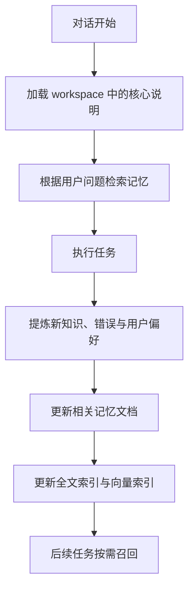

# 第一章：构建知识与记忆驱动的 Agent

学习日期：2026-11-16  
学习来源：Easy Data × AI · Task 1（F0～F2）

> 本文为个人学习笔记，保留原笔记的知识结构并修正明显错字。能力公式属于直观概括；架构占比尚未核实，未作为事实列出。

## F0：Agent 相关常识

### 知识与记忆更新闭环

下面是一种基于 workspace 文件与检索的实现思路，具体加载和更新行为取决于系统配置。

- 内循环：在任务执行中按需检索记忆，辅助推理与行动。
- 外循环：积累和更新用户偏好、环境信息与经验。
- 调教 Agent 的一个重要环节：搭建和维护 workspace。

### 实操建议

- 主动引导形成 SOP，写成技能说明文件，例如 `SKILL.md`。
- 定期审查 workspace，修正过时、不准确或错误的信息。
- 按任务需要使用多个 Agent，让知识积累更专注于各自领域。
- 备份 workspace。
- 根据任务选择合适的模型。

## F1：大模型本质与边界

| 局限 | 可以采用的补充方式 |
| --- | --- |
| 幻觉与事实错误 | RAG、知识库、文档和 SOP 提供依据，同时检查输出；不能保证完全消除幻觉 |
| 知识截止与更新滞后 | 接入更新的数据源、API 或流式数据 |
| 个性化盲区：缺少用户与业务信息 | 建立用户画像、偏好、历史对话与规则等记忆 |

课堂中的直观概括：**AI 能力上限 ≈ 数据质量 × 模型能力**。这不是严格的定量公式，用来提醒自己关注数据质量。

## F2：AI Agent

课堂中的直观概括：**Agent 能力 ≈ 模型能力 × 数据质量 + 流程编排**。

- 基本循环：感知 → 推理 → 行动 → 观察 → 继续行动或结束。
- 核心组成：Memory、LLM、Planning、Tool Use。

### ReAct 与流程编排

**ReAct：Reasoning + Acting**

- 将推理与行动交替进行，根据工具返回的观察继续决策。
- 模型可自主决定何时调用工具、何时返回结果。
- 灵活性较高，适合开放式任务。
- 工具调用是实现这种循环的基础能力之一，单次 Function Calling 不等同于完整的 ReAct。

**流程编排：Workflow**

- 用预定义的流程将多个步骤按顺序和条件串联。
- 显式定义节点（Node）与边（Edge）。
- 支持条件分支、循环和并行执行。
- 可控性较强，适合明确的业务流程。
- 相关工具与方案：LangGraph、Dify 工作流、RPA + AI。

两者可以结合使用，不必视为互斥分类。原笔记中的架构使用占比没有核实来源，暂不保留具体百分比。

### RAG：检索增强生成

- **Naive RAG**：通常采用固定流程，将一次检索结果注入 prompt；面对复杂查询时，多轮检索和策略调整能力有限。
- **Agentic RAG**：由 Agent 判断是否检索、检索哪里以及是否再次检索；可结合多轮检索、策略调整与多来源核对。

影响因素：

- 知识库质量：文档完整性、准确性与更新频率。
- 切分策略：chunk size、overlap。
- 检索策略：向量检索、全文检索或混合检索。
- Embedding 模型的选择。

### MCP：Model Context Protocol

MCP 用于标准化模型应用与外部工具、数据的接入。

- 传统逐一适配的集成关系，可以粗略理解为 M × N。
- 统一协议后，工具侧实现 Server，应用侧接入 Client，可用 M + N 帮助理解适配工作的变化；这不是实际工程成本的严格公式。
- 三类主要能力：Tools（执行操作）、Resources（提供数据）、Prompts（交互模板）。

### Skill：结构化技能与可复用流程

- 可以把技能理解为操作经验和程序性知识的显式化。
- 内容可以包含操作流程、领域规则、成功案例和术语表。
- 效果取决于流程是否清晰可执行、技能能否被准确发现与匹配，以及复用性。

### Memory：个性化信息积累与召回

按内容理解：

| 类型 | 内容示例 |
| --- | --- |
| 语义记忆 Semantic Memory | 事实、用户偏好 |
| 情景记忆 Episodic Memory | 过去的事件、任务经验 |
| 程序性记忆 Procedural Memory | 行为规则、操作方法与技能 |

工作记忆（Working Memory）侧重当前任务中暂时保持和使用的信息，不宜简单等同于行为准则。记忆的内容类型与保存时长是不同的划分维度。

影响记忆效果的因素：记忆提炼质量、召回策略、更新与遗忘机制（例如过时信息的降权）。

### Agent 数据引擎

- 向量数据与索引：支持语义检索。
- 全文索引：支持关键词匹配。
- 关系数据：支持条件过滤和结构化查询。

## 后续学习问题

- 哪些信息适合保存为长期记忆，哪些只需要留在当前上下文？
- 如何检查召回的记忆是否过时或存在冲突？
- 如何用一个小实验比较普通 RAG 与 Agentic RAG？

## 参考与核对入口

- 课程：Easy Data × AI，Task 1，F0～F2。
- [LangChain：Memory overview](https://langchain-ai.github.io/langgraph/concepts/memory/)

[返回学习目录](../README.md)
